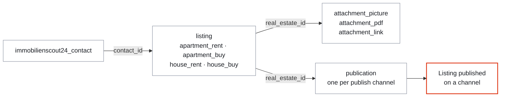
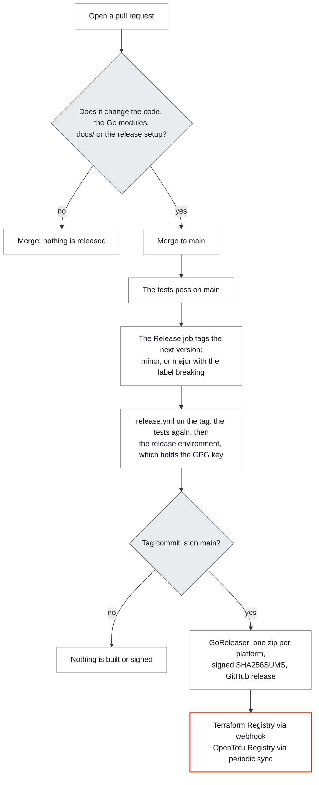

<div align="center">


# 🏠 terraform-provider-immobilienscout24

### German real estate listings as code, on Terraform and OpenTofu.

**An unofficial provider for [ImmobilienScout24](https://www.immobilienscout24.de/).** It manages
apartments and houses for rent and for sale, with their energy certificate, their publication, their
contact addresses and their pictures, PDF documents and links. It is built on the
[ImmobilienScout24 Import/Export API](https://api.immobilienscout24.de/api-docs/import-export/introduction/)
and the Terraform Plugin Framework.

<br>

[](https://registry.terraform.io/providers/agusgonzaleznic/immobilienscout24)
[](https://search.opentofu.org/provider/agusgonzaleznic/immobilienscout24)
<br>
[](https://github.com/agusgonzaleznic/terraform-provider-immobilienscout24/releases)
[](go.mod)
[](LICENSE)

<br>

**[What this is](#-what-this-is) · [Quick start](#-quick-start) · [Resources](#-resources) · [Configuration](#-configuration) · [Energy certificate](#-energy-certificate) · [Publishing](#-publishing) · [Contacts](#-contacts) · [Attachments](#-attachments) · [Limitations](#-limitations) · [Development](#development) · [Releases](#-how-a-release-happens) · [Security](#-security) · [Support](#-support-this-project)**

</div>

---

## 🧭 What this is

This provider lets a portfolio of listings live in a repository: reviewed in a pull request,
planned before it changes, and rebuilt from code when it has to. Each listing, contact,
publication and attachment is a Terraform resource, and an existing listing can be imported by its
scout object id.

> [!NOTE]
> The provider is early. It follows the API documentation, the live XSD, and the listing,
> energy, publish, contact and attachment calls observed on the ImmobilienScout24 sandbox. It has five
> live acceptance tests against the sandbox: together they create, update, import and destroy a
> listing of every type, with energy certificates, and one of them also publishes its listing and
> manages its contact and attachments. I haven't used it against the production API. See
> [limitations](#-limitations).

---

<a id="installation"></a>

## ⚡ Quick start

The provider is on the [Terraform Registry](https://registry.terraform.io/providers/agusgonzaleznic/immobilienscout24)
and the [OpenTofu Registry](https://search.opentofu.org/provider/agusgonzaleznic/immobilienscout24), so
`terraform init` or `tofu init` installs it from the `required_providers` block below.

```hcl
terraform {
  required_providers {
    immobilienscout24 = {
      source = "agusgonzaleznic/immobilienscout24"
    }
  }
}

provider "immobilienscout24" {
  environment = "sandbox"
}

resource "immobilienscout24_apartment_rent" "example" {
  title        = "Bright two-room apartment near Nordbahnhof"
  show_address = true

  address = {
    street       = "Invalidenstrasse"
    house_number = "65"
    postcode     = "10557"
    city         = "Berlin"
  }

  base_rent       = 950
  living_space    = 62.5
  number_of_rooms = 2

  courtage = {
    has_courtage = "NO"
  }
}
```

`immobilienscout24_apartment_buy`, `immobilienscout24_house_rent` and `immobilienscout24_house_buy` work the same
way, with the attributes of their type. Every attribute is described in [docs/resources/](docs/resources/), for
example in [docs/resources/apartment_rent.md](docs/resources/apartment_rent.md). An existing listing can be
imported by its scout object id:

```sh
terraform import immobilienscout24_apartment_rent.example 315000001
```

| You need | Detail |
|---|---|
| Terraform or OpenTofu | [Terraform](https://developer.hashicorp.com/terraform/install) or [OpenTofu](https://opentofu.org/docs/intro/install/). CI runs the acceptance tests on Terraform 1.14 and 1.16 and on OpenTofu 1.11 and 1.12, so 1.14 and 1.11 are the oldest versions I test. The provider declares no minimum of its own |
| API credentials | OAuth 1.0a: a consumer key and secret, plus an access token and secret, for example your personal access token. See [Get Your Client Credentials](https://api.immobilienscout24.de/api-docs/get-started/get-your-client-credentials/). Keys are issued per environment (sandbox or production) |
| Go, to build from source only | [Go](https://go.dev/doc/install) 1.26 or newer. `go.mod` also names the 1.27.4 toolchain, which Go downloads by itself |

<details>
<summary><b>Use a local build instead of the registry</b></summary>

Build the binary into your Go bin directory:

```sh
git clone https://github.com/agusgonzaleznic/terraform-provider-immobilienscout24.git
cd terraform-provider-immobilienscout24
go install .
```

Then add this to `~/.terraformrc`, replacing the path with the output of `go env GOBIN` (or
`$(go env GOPATH)/bin` when that is empty). With `dev_overrides` in place, skip `terraform init` and run
`terraform plan` directly:

```hcl
provider_installation {
  dev_overrides {
    "agusgonzaleznic/immobilienscout24" = "/Users/you/go/bin"
  }
  direct {}
}
```

</details>

---

## 🧩 Resources

| Resource | Manages |
|----------|---------|
| [`immobilienscout24_apartment_buy`](docs/resources/apartment_buy.md) | An apartment for sale |
| [`immobilienscout24_apartment_rent`](docs/resources/apartment_rent.md) | An apartment for rent |
| [`immobilienscout24_attachment_link`](docs/resources/attachment_link.md) | A link of a listing, such as a video or a virtual tour |
| [`immobilienscout24_attachment_pdf`](docs/resources/attachment_pdf.md) | A PDF document of a listing, uploaded from a local file |
| [`immobilienscout24_attachment_picture`](docs/resources/attachment_picture.md) | A picture of a listing, uploaded from a local file |
| [`immobilienscout24_contact`](docs/resources/contact.md) | A contact address that listings show |
| [`immobilienscout24_house_buy`](docs/resources/house_buy.md) | A house for sale |
| [`immobilienscout24_house_rent`](docs/resources/house_rent.md) | A house for rent |
| [`immobilienscout24_publication`](docs/resources/publication.md) | The publication of a listing on one publish channel |

Every resource supports create, read, delete and import, and every one but the publication supports update. The
resources point at each other. A listing names its contact with `contact_id`, and pictures, PDF documents, links
and publications name their listing with `real_estate_id`, so Terraform creates them in that order.



Arrows read as "must exist first", up to the published listing. The contact and the attachments are optional: a listing with neither
still works, and shows the account's default contact.

---

## 🔑 Configuration

Pass the credentials through environment variables so they never appear in your Terraform files:

| Provider attribute    | Environment variable                    |
|-----------------------|-----------------------------------------|
| `consumer_key`        | `IMMOBILIENSCOUT24_CONSUMER_KEY`        |
| `consumer_secret`     | `IMMOBILIENSCOUT24_CONSUMER_SECRET`     |
| `access_token`        | `IMMOBILIENSCOUT24_ACCESS_TOKEN`        |
| `access_token_secret` | `IMMOBILIENSCOUT24_ACCESS_TOKEN_SECRET` |

A value set in the provider block wins over the environment variable. All four are sensitive.

`environment` selects the API: `sandbox` (the default, `https://rest.sandbox-immobilienscout24.de/restapi/api`)
or `production` (`https://rest.immobilienscout24.de/restapi/api`). `base_url` replaces the API root entirely;
it exists for tests and advanced use, and conflicts with `environment`. It must be an `https` URL, except for a
loopback host (`localhost`, `127.0.0.0/8` or `::1`), such as a local fake of the API, which may use `http`.

---

## 🔋 Energy certificate

Every listing resource takes the energy certificate and the energy values of the building:

```hcl
resource "immobilienscout24_house_rent" "example" {
  # ...
  energy_certificate = {
    availability     = "AVAILABLE"
    creation_date    = "FROM_01_MAY_2014"
    efficiency_class = "A"
  }
  construction_year           = 2015
  heating_type                = "HEAT_PUMP"
  energy_sources              = ["ELECTRICITY", "ENVIRONMENTAL_THERMAL_ENERGY"]
  building_energy_rating_type = "ENERGY_REQUIRED"
  thermal_characteristic      = 45.2
}
```

- The plan checks the rules ImmobilienScout24 enforces, so that a combination it refuses fails before anything is
  sent. An `efficiency_class` needs `creation_date = "FROM_01_MAY_2014"` and a `building_energy_rating_type` of
  `ENERGY_REQUIRED` or `ENERGY_CONSUMPTION`. With `availability` set to `NOT_AVAILABLE_YET` or `NOT_REQUIRED`,
  leave out the creation date, the class, the thermal characteristic and the rating type. The other rules, such as
  those for `energy_consumption_contains_warm_water`, are in the docs of each listing resource, for example
  [docs/resources/house_rent.md](docs/resources/house_rent.md).
- `energy_sources` is a set, because ImmobilienScout24 returns the sources in an order of its own, and defaults to
  `["NO_INFORMATION"]`, as the API does. Every create, read and update of a listing asks for the newer sources, such
  as `ENVIRONMENTAL_THERMAL_ENERGY`, which the API only takes and returns with
  `usenewenergysourceenev2014values=true`; a delete does not send it.
- ImmobilienScout24 derives fields of its own from these, such as `heatingType`, `firingTypes` and the
  certificate's `legalConstructionYear`. They are not managed and cause no difference in a plan.
- Decimal numbers take at most two decimal places, because ImmobilienScout24 rounds them to two (`95.555` would
  come back as `95.56`), so the plan refuses more. That holds for every price, area and number of rooms; the
  coordinates are exempt.

---

## 📣 Publishing

New listings are created unpublished. An `immobilienscout24_publication` publishes a listing on one publish
channel, and destroying it unpublishes the listing on that channel only:

```hcl
resource "immobilienscout24_publication" "portal" {
  real_estate_id = immobilienscout24_apartment_rent.example.id
  channel_id     = "10000" # ImmobilienScout24 (www.immobilienscout24.de); 10001 is the realtor's own homepage
}
```

> [!WARNING]
> In production, publishing on channel `10000` uses the paid contingent of your ImmobilienScout24 account, and
> without contingent the API answers `No contingent available`. Try a configuration on the sandbox first (the
> default `environment`), where no bookings take place.

- Publishing on `10000` activates the listing. Unpublishing it there deactivates the listing, even while it stays
  published on `10001`. Changing `real_estate_id` or `channel_id` unpublishes and publishes anew, and deleting a
  listing also removes its publications.
- If a listing is already published on the channel, creating the publication fails with the command that imports
  it. A publication's id is `{real_estate_id}_{channel_id}`, so `terraform import immobilienscout24_publication.portal 315000001_10000`
  imports the publication above.
- The API documentation asks for publish requests one after the other, so the provider sends them one at a time,
  even when Terraform creates several publications in parallel.

---

## 📇 Contacts

A listing shows one contact address. An `immobilienscout24_contact` manages one, and `contact_id` on a listing, as in
`contact_id = immobilienscout24_contact.leasing.id`, points the listing at it:

```hcl
resource "immobilienscout24_contact" "leasing" {
  email        = "vermietung@example.com"
  lastname     = "Beispiel"
  phone_number = "+49 30 24301999"
}
```

- The Terraform state holds the personal data of each contact, such as names, email addresses and phone numbers,
  so keep it in an access-controlled, encrypted backend.
- Phone numbers are written like `+49 30 24301999`: the country code starts with `+`, not `00`, and after `+49`
  the area code has no leading `0`. [docs/resources/contact.md](docs/resources/contact.md) lists every field.
- Every account has exactly one **default contact**, which a listing without a contact gets. Setting
  `default_contact = true` makes a contact the default, and the previous default loses the flag. Setting
  `default_contact = false` is rejected, because ImmobilienScout24 ignores it. Leave the attribute out to keep the
  current flag. Set it to `true` on one contact only: when two contacts both set it, the apply fails with "Another
  contact became the default contact".
- ImmobilienScout24 refuses to delete the default contact. To destroy it, first make another contact the default,
  with `default_contact = true` on another `immobilienscout24_contact` or on the website. Moving the default to a
  new contact and removing the old one in the same apply works: the provider waits up to 15 seconds for the new
  contact to take the default before it gives up deleting the old one.
- Destroying a contact moves the listings that use it to the default contact. An update replaces the whole contact, so the fields the resource does not model (`company`, `officeHours`,
  `portraitUrl`, `clickOutUrl`, `localPartnerContact`, `businessCardContact`) are reset. An existing contact can be
  imported by its id: `terraform import immobilienscout24_contact.leasing 124309506`.

### Upgrading

| Changed in | What changed | What to do when upgrading from v0.1.0 |
|---|---|---|
| v0.2.0 | Updates no longer reset a listing's contact. Up to v0.1.0, every update of an `immobilienscout24_apartment_rent` reset the listing to the account's default contact, because the provider never sent one, and a contact chosen on the website was lost on the next `terraform apply` that changed the listing. The resource now sends the listing's contact on every update: the configured `contact_id`, or, without one, the contact the listing already has | Nothing |
| v0.2.0 | `immobilienscout24_apartment_rent` manages the energy certificate and the energy values of the building (`energy_certificate`, `construction_year`, `heating_type`, `energy_sources`, `building_energy_rating_type`, `thermal_characteristic` and `energy_consumption_contains_warm_water`) | For a listing whose energy data was set outside Terraform, the first plan after upgrading shows an in-place update that would remove it: add the energy attributes to the configuration before applying. `energy_sources` and `energy_consumption_contains_warm_water` are filled in from the API on refresh and cause no change on their own |

---

## 📎 Attachments

Pictures and PDF documents are uploaded from local files; links point anywhere on the web. Each attachment names
its listing with `real_estate_id`. A picture takes a `file` and a `title`, and `title_picture = true` makes it the
title picture. A PDF document takes a `file` and a `title` the same way, with `floorplan = true` for a floor plan.
A link takes a `url` and a `title`. Examples are in
[docs/resources/attachment_picture.md](docs/resources/attachment_picture.md),
[docs/resources/attachment_pdf.md](docs/resources/attachment_pdf.md) and
[docs/resources/attachment_link.md](docs/resources/attachment_link.md).

- **The file of an attachment cannot be changed.** ImmobilienScout24 only updates the metadata (`title`,
  `external_id`, `floorplan`, `title_picture`), so new content in `file` replaces the attachment: the plan shows a
  replacement, and the new upload gets a new id. The provider tells content apart by its SHA-256 (`file_sha256`),
  which it stores as the attachment's `externalCheckSum`; a new path to the same content uploads nothing.
- **Every listing with pictures has exactly one title picture**, the first picture in the attachment order. The
  first picture uploaded becomes it, also without `title_picture`. Setting `title_picture = true` makes a picture the
  title picture, and the previous one loses the flag. `title_picture = false` is rejected, because ImmobilienScout24
  ignores it. Deleting the title picture makes the next picture the title picture. Set `title_picture = true` on one
  picture per listing only: when two pictures set it, the apply that writes both fails with "Two pictures set
  title_picture = true".
- ImmobilienScout24 accepts up to 150 pictures and PDF documents per listing, each at most 50 MB, and up
  to 150 links. Titles have at most 30 characters. The content type follows from the file's extension (`.jpg`,
  `.jpeg`, `.png`, `.gif`, `.pdf`), or from `content_type`.
- **Titles are optional.** A picture or PDF document without `title` is titled with its file name without the
  extension, cut to 30 characters, and that title is shown on the listing, so name the files accordingly. The
  provider sends this title itself, because ImmobilienScout24 would read the name of the uploaded file as Latin-1
  and show `Küche 1.jpg` as "Küche 1". A link without `title` gets `Link` from ImmobilienScout24. Removing
  `title` from the configuration later keeps the current title.
- **A file must stay the same between plan and apply.** If it changes after `terraform plan`, Terraform stops the
  apply with "Provider produced inconsistent final plan", and nothing is uploaded. Plan again. When a file that
  was uploaded is missing, the plan keeps the attachment as it is and warns, so that `terraform destroy` still works.
- Deleting a listing outside Terraform deletes its attachments too; the next plan creates both anew.
- An existing attachment can be imported by `{real_estate_id}/{attachment_id}`, for example
  `terraform import immobilienscout24_attachment_picture.living_room 315000001/904864036`. ImmobilienScout24 does
  not return the file, so the configuration names it as usual; the next apply keeps the attachment when its
  `externalCheckSum` is the SHA-256 of that file, and uploads it again otherwise, which is the case for attachments
  uploaded by other software.

---

## 🚧 Limitations

What the provider doesn't do:

| Limit | Detail |
|---|---|
| Tested on the sandbox, not on production | Production API access is paid, so the provider has only been run against the sandbox. See [development](#development) |
| Apartments and houses only | The four listing types for rent and for sale are supported; other real estate types, such as plots and commercial ones, are not. Importing a listing into a resource of another type fails with an error rather than misreading it |
| Partial field coverage | The listing resources model the mandatory fields, the energy certificate and the common optional fields. Updates are full replacements on the API side, so fields they do not model (the condition, the number of bedrooms and so on) may be reset when Terraform updates a listing that was edited elsewhere. The listing's contact is kept. Attachments are resources of their own, apart from the listing |
| No streaming videos, no attachment order | Videos uploaded to ImmobilienScout24 are not supported; a link to a video is. The attachment order holds pictures and PDF documents only (not links), and is left to ImmobilienScout24, except for the title picture |
| Delete is a hard delete | ImmobilienScout24 recommends deactivating listings instead of deleting them; `terraform destroy` deletes |
| Publish requests wait for each other within one provider configuration | Two provider configurations (for example aliases) for the same account can still publish in parallel |
| No automatic retry on rate limiting | HTTP 429 is not retried. The sandbox allows at most 200 write calls per minute |

---

<a id="development"></a>

## 🛠️ Development

```sh
make test      # unit tests, no network
make testacc   # acceptance tests against the local fake API, with Terraform
TF_ACC_TERRAFORM_PATH=$(which tofu) TF_ACC_PROVIDER_NAMESPACE=hashicorp TF_ACC_PROVIDER_HOST=registry.opentofu.org \
  make testacc # the same with OpenTofu
make lint
make generate  # regenerate docs/ from the schema and examples/
```

`docs/` is generated from the schema and `examples/`, and CI fails when it is out of date, so edit those and never the
generated files.

The acceptance tests start an in-process fake of the API that checks the OAuth signature, the documented headers,
and the element order of every listing, contact and attachment body against the live XSD in
`immobilienscout24/testdata/` (for contacts, against the order of IS24's newer per-file XSD, which that one predates,
and for attachments, against that XSD with the newer `externalCheckSum` added), and that fails publish requests
which overlap. It mirrors the listing, contact and attachment behaviour observed on the sandbox,
including the fields the sandbox fills in, the rounding of decimals, the energy rules, the default contact rules,
the multipart uploads, the titles it fills in and the title picture rules. A test replays requests recorded on the
sandbox (`immobilienscout24/testdata/sandbox/`) and compares the fake's answers with the sandbox's. The tests need a
`terraform` or `tofu` binary but no credentials.

<details>
<summary><b>The live sandbox tests</b></summary>

The live sandbox test runs only when asked for explicitly. It creates a contact and an apartment that shows it,
uploads two pictures (one untitled, named `Küche 1.jpg`) and a link, publishes the apartment on channel `10000`,
updates it, unpublishes it, deletes the attachments, checks on the sandbox that they are gone, and destroys the
rest. It never changes the account's default contact:

```sh
TF_ACC=1 IMMOBILIENSCOUT24_LIVE=1 \
  IMMOBILIENSCOUT24_CONSUMER_KEY=... IMMOBILIENSCOUT24_CONSUMER_SECRET=... \
  IMMOBILIENSCOUT24_ACCESS_TOKEN=... IMMOBILIENSCOUT24_ACCESS_TOKEN_SECRET=... \
  go test ./immobilienscout24 -run TestAccApartmentRent_liveSandbox -v
```

Four more live tests (an apartment for sale, a house for rent, a house for sale, and the energy attributes of an
apartment for rent) each create a listing, update, import and destroy it, and check on the sandbox that it is gone.
They set no contact, so each listing shows the default contact. `-run _liveSandbox` runs all five.

</details>

---

## 🔁 How a release happens

The merge of a pull request is the release. Nobody pushes a tag by hand.



- A pull request that changes what ships (`immobilienscout24/`, `main.go`, `go.mod`, `go.sum`, `docs/`,
  `terraform-registry-manifest.json`, `.goreleaser.yml` or `release.yml`) releases a new version when it merges,
  and its check `Release / Check the version` names it. The tags set the version: the minor version goes up, or the
  major version when a pull request merged since the last release has the label `breaking`. A merged Dependabot
  update of a Go module changes `go.mod` and `go.sum`, so it releases a version too.
- On main, once the tests pass, the Release job in [`ci.yml`](.github/workflows/ci.yml) tags `vX.Y.Z` and starts
  [`release.yml`](.github/workflows/release.yml) on the tag. It runs the whole test workflow again on the tagged
  commit, then a job in the `release` environment, the only place the signing key lives, which accepts `v*` tags
  only. That job checks that the tag is on main, and GoReleaser builds the zips and signs their `SHA256SUMS`.
  [`.goreleaser.yml`](.goreleaser.yml) builds for freebsd, windows, linux and darwin, with `CGO_ENABLED=0` and
  `-trimpath`, and lists the registry manifest ([`terraform-registry-manifest.json`](terraform-registry-manifest.json),
  protocol 6.0) in the checksums.

---

## 🔐 Security

Please report a vulnerability privately in the **Security** tab, as the
[security policy](https://github.com/agusgonzaleznic/.github/blob/main/SECURITY.md) describes, never in a public
issue. Include the provider version and the steps to reproduce.

Every release is signed with the GPG key `131CD2FD69BA525373F222FD51BEA00CE6BEAD92`, which the Terraform Registry
and the OpenTofu Registry check on `terraform init` and `tofu init`. The key signs the release's `SHA256SUMS`, which
lists the checksum of every archive.

---

## 💛 Support this project

It's free and stays free, and I'm glad to share it. Three things help, in ascending order of effort:

- **Star the repo.** It tells the next person who manages listings as code that this exists.
- **Open an issue** when the provider and the ImmobilienScout24 API disagree. A request and a response
  that show it are the most useful report I can get.
- **Drop a coffee on Ko-fi, or sponsor on GitHub**, if this saved you a day of clicking through the
  portal. Ko-fi is a one-off, and GitHub Sponsors can be monthly or one-time, with a custom
  amount.

<div align="center">
<br>

[](https://ko-fi.com/agusgonzaleznic)
[](https://github.com/sponsors/agusgonzaleznic)
<br>
[](https://agusgonzaleznic.com)
[](https://github.com/agusgonzaleznic)
[](https://www.linkedin.com/in/agusgonzaleznic)

<br>

<sub>Built in Berlin by <b>Agustin Gonzalez Nicolini</b>. I work on engineering leadership and write
about it at <a href="https://agusgonzaleznic.com">agusgonzaleznic.com</a>.</sub>

</div>

---

## 📄 Licence

[MIT](LICENSE), copyright 2025 Agustin Gonzalez Nicolini. This is an unofficial provider.
